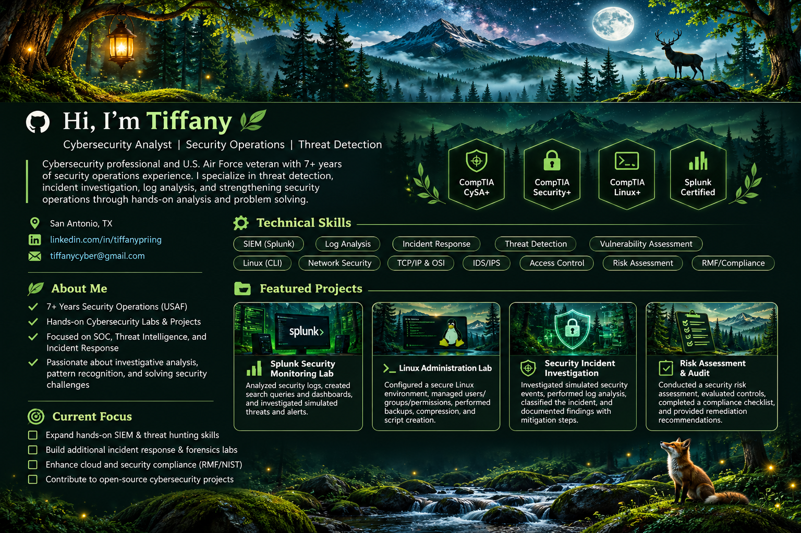

🌲 Explore the projects
Linux Administration Lab · Security Risk Assessment · Splunk Monitoring (Planned) · Incident Investigation (Planned)

> **About the design:** The forest scene above is a visual portfolio concept. The sections below contain the actual, accessible profile information and project links. Replace placeholders with your own repositories as you publish them.
🍃 About Me
I'm a U.S. Air Force veteran with 7+ years of security operations experience in alarm monitoring, incident investigation, access control, event documentation, and security response coordination. I'm building on this foundation through hands-on cybersecurity training and technical projects.
Certifications: CompTIA CySA+ · Security+ · Linux+ · Splunk
🌿 Technical Skills
Security operations: Alert triage, incident documentation, investigations, escalation, pattern recognition  
Monitoring: Splunk, log analysis, SIEM fundamentals, IDS/IPS concepts  
Systems: Linux CLI, users and permissions, backups, scripting fundamentals, virtualization  
Networking: TCP/IP, OSI model, tcpdump, network troubleshooting  
Risk & compliance: Security control evaluation, risk assessments, audit checklists
🐧 Linux Administration Lab
Completed a hands-on Linux lab covering company filesystem creation, user and group permissions, backups, compression, and scripting. Add your project repository link here once published.
🛡️ Security Risk Assessment
Completed a training security audit and controls checklist for a fictional organization. Add a sanitized project repository link here once published.
🔍 Splunk Monitoring (Planned)
A future lab focused on searching security logs, investigating alerts, and documenting findings.
🌙 Incident Investigation (Planned)
A future simulated security incident case study demonstrating alert triage, evidence review, escalation, and reporting.
---

<i>🌱 Growing one lab at a time.</i>

